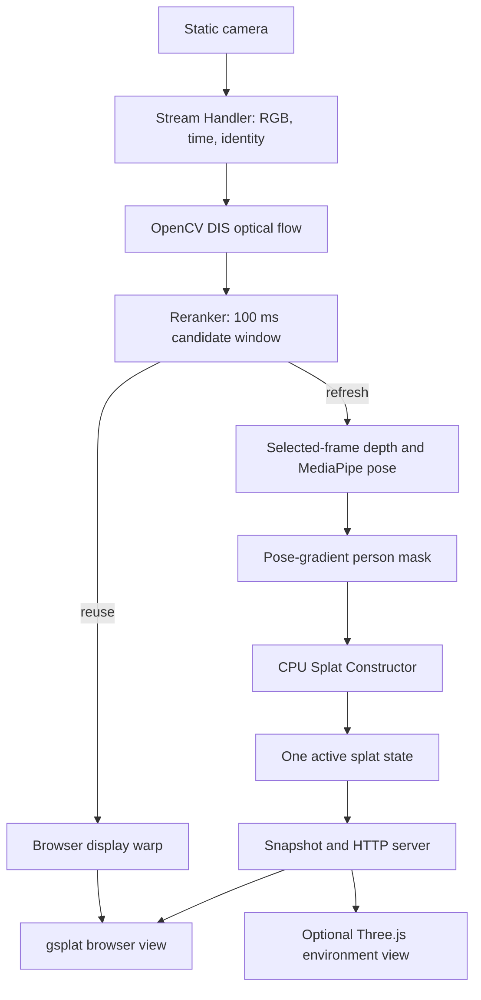

# Milestone workflow: one camera to a live splat view

The milestone application makes a depth-guided Gaussian splat view from one
static camera on one computer. The camera can be a webcam, OBS Virtual Camera,
or ZED 2i. The webcam is the default. A browser shows the source frame,
inference previews, diagnostics, and the newest valid splat state. The
[runbook](integration_runbook.md) gives the launch commands. The
[integration architecture](integration.md) defines the component boundaries.

## Delivered data flow

Optical flow compares each candidate with the retained significant frame.
The reranker uses flow magnitude to choose a refresh frame. Background motion
can win a window. Depth, pose, and mask selection run on the selected refresh
only. A timed refresh can request a new state when motion is low. The
retained reference advances after a valid construction. A failed refresh
leaves the last valid state available.

Webcam and OBS refreshes use YOLO depth. A ZED refresh can use SDK depth. An
experimental ZED option uses the synchronized left and right images for
StereoSGBM depth on the selected frame. The right image contributes depth,
not another splat color view. The [stereo result](STEREO_DEPTH_EXPERIMENT_PLAN.md)
states its validation limit.

## Mask, state, and display

The current mask uses visible pose joints to select the subject in the depth
plane. A depth-threshold band is the fallback. Joint-depth validity also
prevents distant background pixels inside the face or body silhouette from
making splats. The [milestone reflection](Integration-Enhancements.md)
states the observed improvement and its limits.

The native constructor projects selected pixels into the camera view and
stores position, color coefficients, opacity, scale, rotation, weight, and
source pixel. The server publishes the state, mask, and pose-depth preview
as one snapshot. The browser accepts responses only when their run and
frame identity match the active state. The
[representation guide](splat-representation-and-runtime.md) gives the
array formats and browser conversion.

Each successful refresh replaces the active state. A reuse decision moves
only the displayed positions with source-view optical flow. It does not
change stored splat positions or fuse geometry across frames. The main
viewer uses `gsplat`. The optional Three.js environment compositor imports
one `.glb` scene and displays the same published splat frames. The
[GUI guide](../applications/gui/README.md) describes its controls.

## What this workflow establishes

The application demonstrates a live, view-conditioned splat visualization.
It does not reconstruct surfaces that the single camera cannot see. Orbit
views can show stretched or missing geometry. The trained mask candidate
and stereo matcher are measured experiments; neither changes the webcam
default. The persistent Temporal Cache, Splat Adjustor, and multi-camera
design in the [original design record](single-camera-design-record.md)
are outside this milestone workflow.
